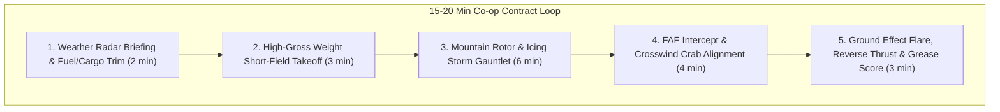

# CROSSWIND: GROUND EFFECT — Game Design & Systems Specification
**The Atmospheric Survival Wedge: "MudRunner in the Sky"**
*Architectural Blueprints & Systems Contract (`Zachariah x Aether`)*

---

## 1. Executive Summary & Creative Pillars

- **Genre:** Hardcore Tactical Flight Survival & Co-op Logistics Simulation
- **Target Price Point:** \$19.99 USD on Steam (PC / Steam Deck / Controller Support)
- **Session Horizon:** 15–20 minute high-stakes contracts with instant restartability.
- **Core Hook:** Unlike traditional flight sims that simulate hours of boring cruise flight, *CROSSWIND* isolates aviation's most terrifying, adrenaline-soaked phases: high-gross takeoff, severe storm penetration, and extreme short-field / crosswind touchdown.
- **Atmospheric Pillar ("Dirty & Sweet"):** 
  - Grimy analog cockpits with vibrating needle gauges, scratched acrylic windshields streaming with heavy rain, slapping wiper blades, and groaning airframes.
  - No autopilot, no fly-by-wire nannies: pure aerodynamic stick-and-rudder execution against punishing mountain microbursts, ice accumulation, and ground effect cushions.

---

## 2. 4–8 Player Co-op Storm Evacuation Architecture

In *CROSSWIND*, multiplayer is not a lonely server list; it is a synchronized race against a dynamic meteorological event:

1. **The Storm Front Clock:**
   - Every contract has a global countdown timer dictated by an encroaching Category 4 blizzard, typhoon, or wildfire wall.
   - Airports at the departure and destination points degrade in real-time (e.g. runway friction drops from $0.8$ tarmac to $0.22$ black ice; crosswind gusts increase from $18\text{ kts}$ to $48\text{ kts}$).
2. **Synchronized Flight Waves & Holding Patterns:**
   - 4 to 8 players take off in staggered 45-second intervals from compromised airfields (logging strips, mountain terraces, ice shelves, pitching carrier decks).
   - If a preceding pilot crashes on the runway or ground-loops on touchdown, the runway is obstructed! Trailing pilots must make a split-second decision: **Go-Around**, divert to an unlit emergency sandbar, or execute an off-center flare over the wreckage.
3. **Scratchy VHF Radio VOIP Network:**
   - Real-time in-game peer-to-peer VOIP modeled on aviation VHF transceivers ($118.000–136.975\text{ MHz}$):
     - **Bandpass Filter:** Strictly clamped to $300\text{ Hz}–3400\text{ Hz}$ with harmonic distortion and subtle white noise.
     - **Squelch Tail & Chirp:** Authentic microphone keying click and squelch burst at start and end of transmission.
     - **Distance & Terrain Shadowing:** Radio signal drops into static if a pilot drops below mountain ridgelines, cutting off communications right when stall horns begin blaring!

---

## 3. Flight Dynamics & Aerodynamic Physics Engine

*CROSSWIND* uses a bespoke sectional aerodynamic model combining **Blade Element Theory (BET)** with physical **Ground Effect** and **Crosswind Kinematics**:

### 3.1 Sectional Blade Element Theory (BET)
The wing is discretized into $N = 10$ spanwise stations per half-span. For each station $i$ with local chord $c_i$, local angle-of-attack $\alpha_i$, and local relative wind velocity $V_i$:
$$L_i = \frac{1}{2} \rho V_i^2 c_i \Delta y \cdot C_L(\alpha_i)$$
$$D_i = \frac{1}{2} \rho V_i^2 c_i \Delta y \cdot C_D(\alpha_i)$$

- **Half-Wing Asymmetric Stall:** If a pilot initiates an uncoordinated turn at low airspeed without rudder deflection, the retreating wing exceeds $\alpha_{\text{critical}} \approx 16^\circ$ first, triggering an immediate autorotation / snap-roll into a spin that requires counter-rudder and forward yoke recovery.

### 3.2 Dynamic Ground Effect Physics ($\sigma$)
When an aircraft descends within one wingspan of the ground ($h / b < 1.0$), the ground physically impedes the formation of wingtip trailing vortices, collapsing downwash $w_d$ and induced drag $C_{D,i}$:
$$\sigma\left(\frac{h}{b}\right) = \frac{16 (h/b)^2}{1 + 16 (h/b)^2}$$
$$C_{D,i} = \sigma\left(\frac{h}{b}\right) \cdot \frac{C_L^2}{\pi e \text{AR}}$$

- **The Gameplay Consequence:** At $h/b = 0.1$ (main gear 4 feet above the runway), induced drag drops by **over 85%**, while the effective lift curve slope steepens:
  $$C_{L_\alpha, \text{eff}} = \frac{C_{L_\alpha}}{1 - \frac{2 C_{L_\alpha}}{\pi^2 \text{AR}} \ln\left(1 + e^{-\pi (h/b)}\right)}$$
- Pilots who carry an extra 10 knots of airspeed on final approach will **float down the entire length of the runway on an invisible air cushion**, unable to touch down before the runway overrun!

### 3.3 Crosswind Crab & Decrab Kinematics
When crabbing into a crosswind $v_w$ with airspeed $V_{\text{TAS}}$:
$$\beta_{\text{crab}} = \arcsin\left(\frac{v_w \cdot \sin(\theta_{\text{runway}} - \theta_{\text{wind}})}{V_{\text{TAS}}}\right)$$
- At 10 feet AGL during flare, the pilot must execute the **"Kick-Decrab"**: applying opposite rudder to align the longitudinal axis with the runway stripe while dipping the upwind wing with aileron to prevent drift.
- **Tire Sideload Mechanics:** Touching down with residual crab angle creates lateral shear force $F_y = \mu_{\text{side}} \cdot m \cdot g \cdot \sin(\Delta \psi)$. Exceeding $\Delta \psi > 8.0^\circ$ on dry tarmac causes immediate tire blowout and violent ground loop!

---

## 4. In-Flight Malfunction Injection Matrix

Contracts dynamically inject emergency failures based on airframe stress, maintenance condition, and extreme weather:

| Failure Mode | Trigger Condition | Flight Deck Symptom | Emergency Pilot Countermeasure |
| :--- | :--- | :--- | :--- |
| **Pitot Tube Icing** | Flying through sub-zero moisture with Pitot Heat OFF | Airspeed indicator slowly bleeds to 0 or freezes at current value. | Fly by pitch attitude and engine RPM/manifold pressure; toggle emergency pitot heat switch. |
| **Asymmetrical Flap Jam** | High-G pull-up or flap deployment at $V_{\text{ext}} > 140\text{ kts}$ | Left flap drops to 40°, right flap jams at 15°. Violent rolling moment. | Full opposite aileron, retract flaps immediately, execute high-speed flapless landing. |
| **Critical Engine Flameout** | High altitude carburetor icing or fuel starvation | Sudden yaw snap toward dead engine, oil pressure alarm, screaming asymmetric drag. | Foot on the "dead foot, dead engine" rudder, feather propeller to reduce windmilling drag, increase throttle on good engine. |
| **Hydraulic Line Failure** | Hard tailstrike or overstressed gear cycle | Flaps deploy at half speed, emergency nosewheel steering offline. | Differential engine throttle steering and manual gravity gear free-fall release. |
| **Cargo Shift** | Severe turbulence ($> +2.5g$ / $-1.0g$) | Sudden aft center-of-gravity (CG) displacement. Nose pitches violently up toward stall. | Full nose-down elevator trim, maximum forward yoke, maintain high thrust to power out of stall. |

---

## 5. Aircraft Fleet Profiles

### 1. "The Iron Mule" — Twin-Turboprop Cargo Hauler
- **Inspiration:** Antonov An-26 / DHC-4 Caribou
- **Max Takeoff Weight:** 24,000 lbs
- **Handling Soul:** Massive rotational inertia, 3.2-second turboprop spool-up lag, heavy control yokes, high sink rate upon throttle cut. Requires planning power changes 4 seconds in advance.

### 2. "The Yukon Beaver" — High-Wing Radial Bush STOL
- **Inspiration:** DHC-2 Beaver on 35-inch Tundra Tires
- **Max Takeoff Weight:** 5,100 lbs
- **Handling Soul:** Ultra-low stall speed (34 kts with full Barn-Door flaps), violent adverse yaw requiring massive rudder coordination, floats like a kite in crosswinds, capable of stopping in 250 feet on gravel riverbars.

### 3. "Viper-Carrier" — High-Alpha Naval Interceptor
- **Inspiration:** F/A-18C Hornet / A-4 Skyhawk
- **Max Takeoff Weight:** 32,000 lbs
- **Handling Soul:** 135-knot on-speed angle-of-attack ($8.1^\circ$) approach; no flare whatsoever—slam into the deck at $-750\text{ ft/min}$ to catch the 3-wire on a pitching, rolling flight deck in 30-foot swells.

---

## 6. Precision Telemetry "Grease Scorecard"

Upon touchdown rollout, the flight recorder computes a cryptographic telemetry scorecard:

$$\text{Score} = \text{Base} (10,000) - \Delta_{\text{FPM}} \cdot 15 - \Delta_{\text{center}} \cdot 25 - \Delta_{\text{rollout}} \cdot 2 - \text{DamagePenalties}$$

- **Touchdown Categories:**
  - **Grease / Butter ($0\text{ to } -120\text{ ft/min}$):** $+2,500$ Bonus points. Silky smooth tire chirps.
  - **Firm ($ -121\text{ to } -350\text{ ft/min}$):** Standard operational touchdown. Safe for wet/icy runways.
  - **Hard ($ -351\text{ to } -600\text{ ft/min}$):** Heavy structural stress, cargo damage penalty, passenger panic.
  - **Gear Collapse ($< -600\text{ ft/min}$):** Airframe hull loss; gear shears off, sparks fly, fuselage skids into the grass.
- **Centerline Accuracy:** Continuous tracking of lateral nosewheel deviation from runway center stripe (measured in inches).
- **Cargo Intactness:** Real-time accelerometer recording: delicate medical supplies or volatile fuel canisters explode if instantaneous $G_z > 3.2g$.

---

## 7. DualSense Native Haptic & Adaptive Trigger Architecture

Leveraging the verified Win32 USB HID proxy from `vibrant-darwin`:

1. **Aerodynamic Dynamic Pressure ($q$) Yoke Resistance:**
   - Left Trigger (L2) and Right Trigger (R2) utilize DualSense Mode `0x21` (Continuous Static Resistance).
   - As indicated airspeed ($V_{\text{IAS}}$) increases, aerodynamic resistance forces on control surfaces increase quadratically:
     $$F_{\text{trigger}} = F_{\min} + (F_{\max} - F_{\min}) \cdot \left(\frac{V_{\text{IAS}}}{V_{\text{VNE}}}\right)^2$$
   - At high diving speeds ($180\text{ kts}$), the triggers become heavy and physically demanding to pull; at low stall speeds ($35\text{ kts}$), the controls become mushy and light!
2. **Pre-Stall Wing Buffet (Mode `0x26`):**
   - When $\alpha \to \alpha_{\text{critical}} - 2^\circ$, airflow detaches from the wing root and buffets the tailplane.
   - DualSense engages a **32 Hz high-amplitude vibration** directly on the yoke axis, giving the pilot tactile muscular warning seconds before the stall horn blares.
3. **Runway Seam & Touchdown Impulse:**
   - Main gear contact triggers an immediate 120 ms low-frequency motor impulse ($220\text{ counts}$) combined with a stereo haptic snap corresponding to whether the left or right tire touched down first in a crosswind bank!
